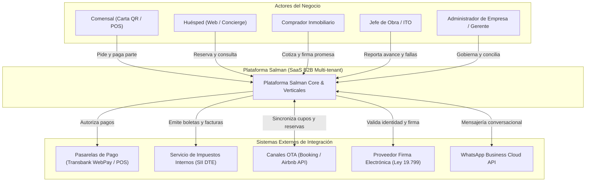
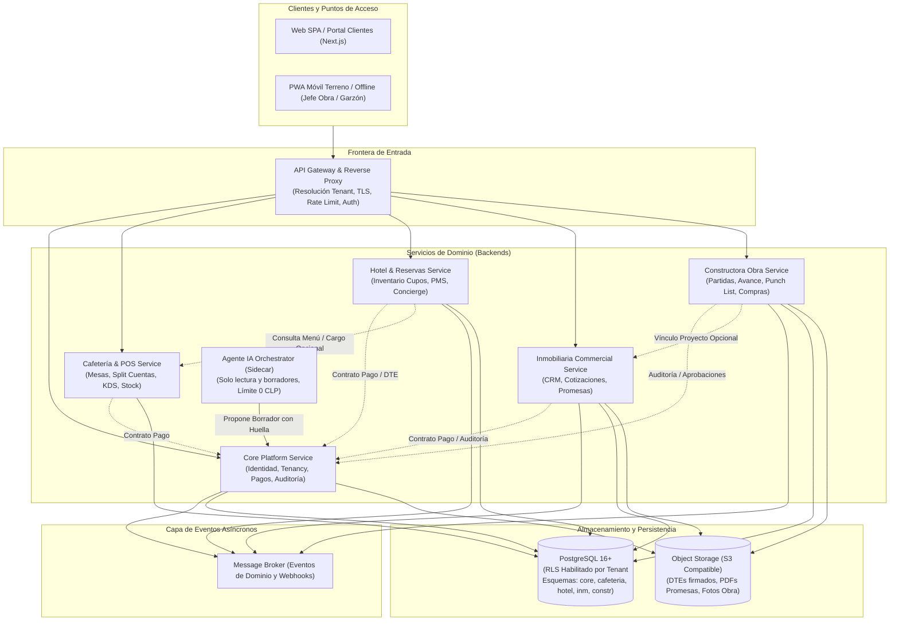

# Arquitectura C4 — Contexto y Contenedores Multi-tenant

**Concilio Técnico:** Arquitecto de Software · Arquitecto de Datos · Especialista AppSec.  
**Modelo:** C4 Model (Nivel 1: Contexto de Sistema, Nivel 2: Contenedores).

---

## 1. Nivel 1: Diagrama de Contexto de Sistema

---

## 2. Nivel 2: Diagrama de Contenedores y Fronteras de Dominio

### Aislamiento y Fronteras Clave
1. **Frontera de Ingress:** El `APIGateway` valida el token JWT del usuario, extrae los tenants permitidos y establece el encabezado inmutable `X-Tenant-ID`.
2. **Contexto de Base de Datos:** Todo servicio establece `SET LOCAL app.current_tenant_id = :tenant_id` al tomar una conexión del pool, activando automáticamente las políticas RLS a nivel de motor PostgreSQL.
3. **Frontera Agéntica:** El contenedor `AgenteSidecar` se ejecuta en una red interna aislada sin acceso de escritura a la base de datos ni a los adaptadores de pago. Sus propuestas se envían como eventos firmados que requieren aprobación humana previa a cualquier mutación de estado.
