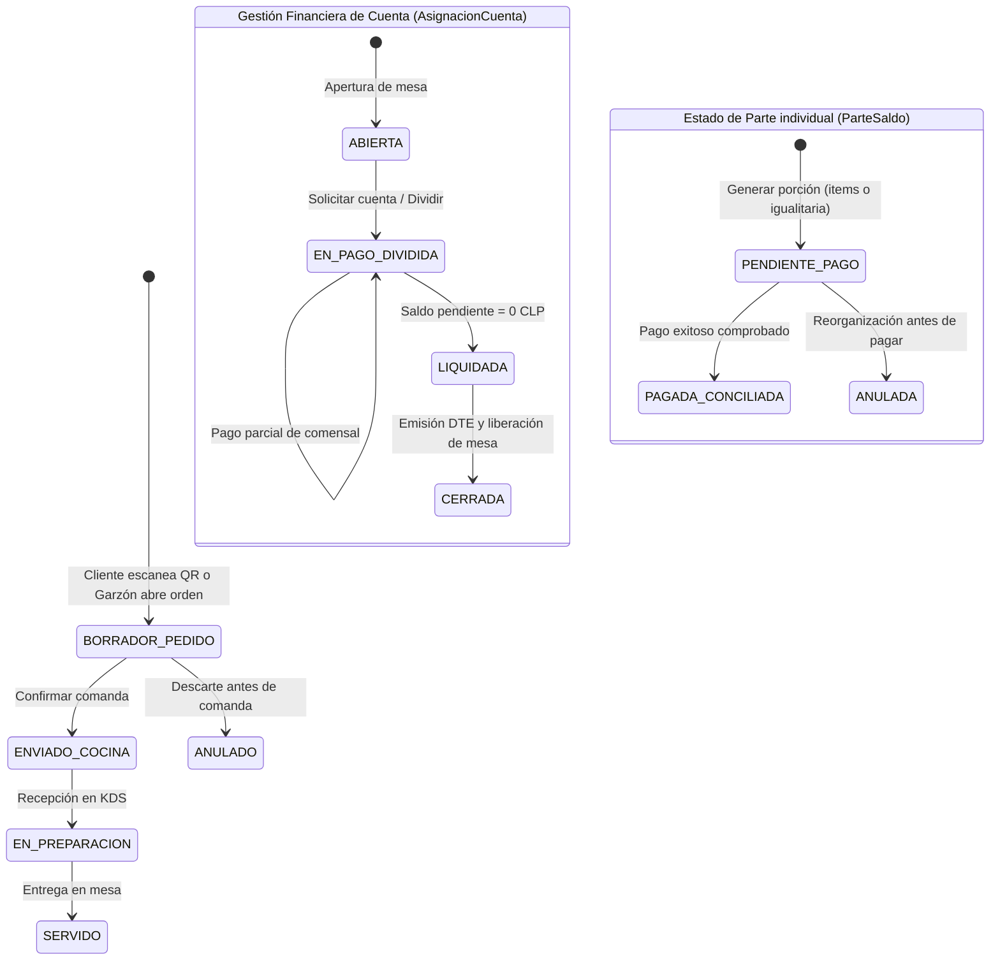
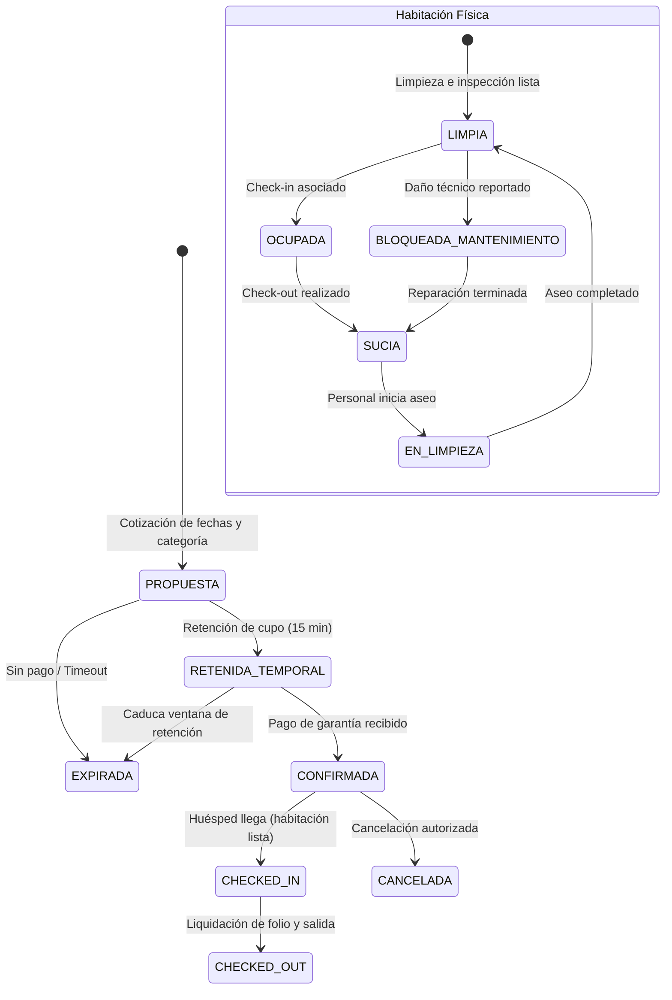
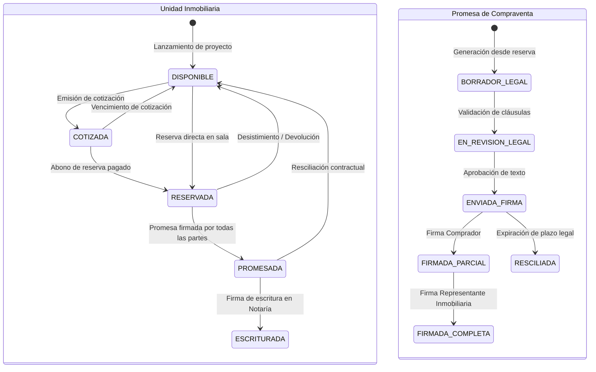
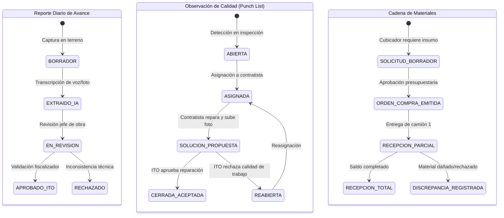
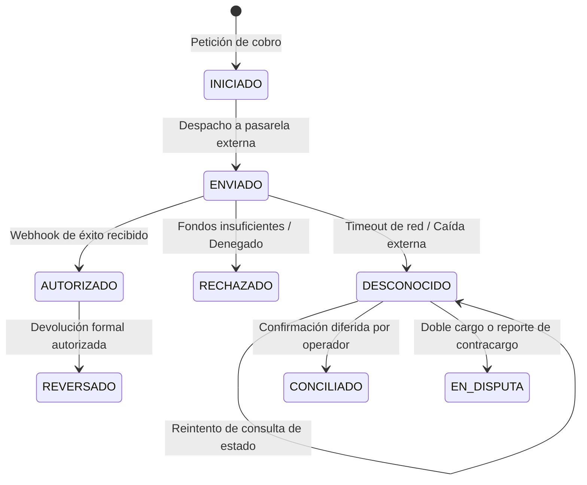
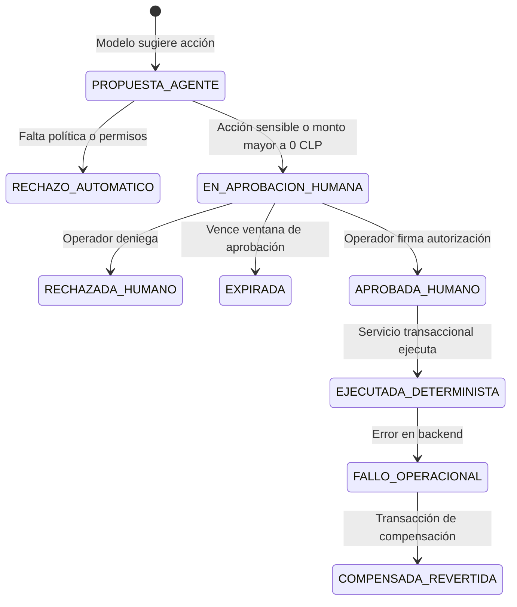
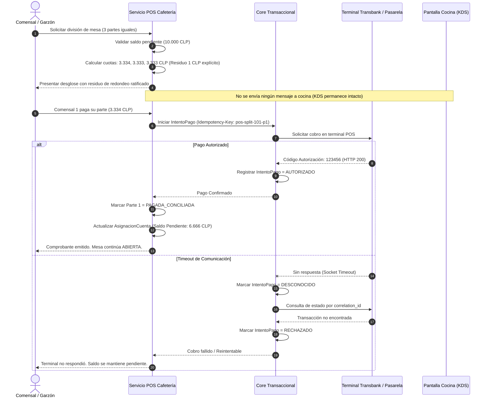
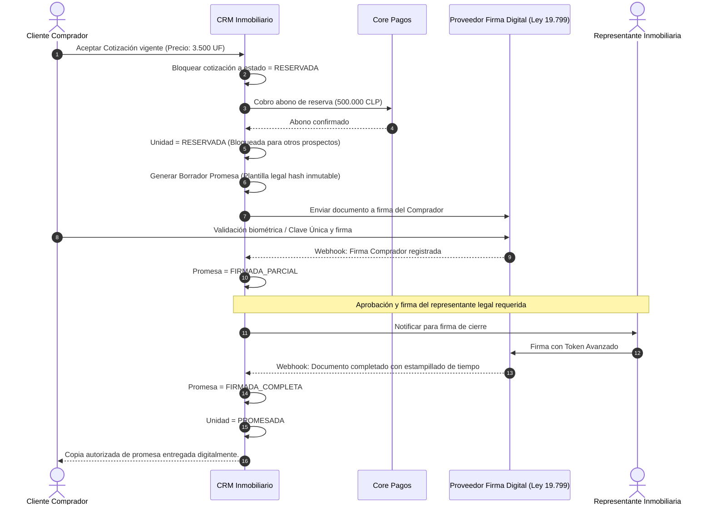
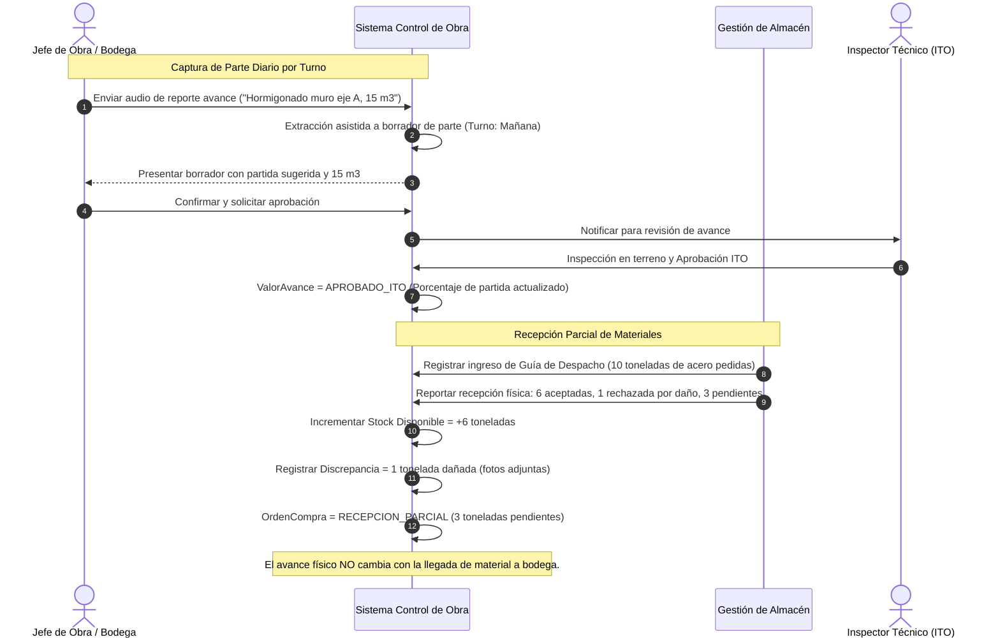

# Diagramas de Comportamiento Dinámico — Máquinas de Estado y Secuencia

**Concilio Técnico:** Arquitecto de Software · Especialista en Modelado de Dominios · QA · Especialista en IA Agéntica.  
**Sintaxis:** Mermaid `stateDiagram-v2` y `sequenceDiagram`.

---

## 1. Máquinas de Estado por Dominio

### A. Cafetería: Ciclo de Vida de Pedido, Cuenta y División (Split)

*Invariante:* Si una `ParteSaldo` pasa a `PAGADA_CONCILIADA`, no puede ser revertida a `PENDIENTE_PAGO` ni cancelada por una reorganización posterior de la mesa. El estado de cocina (`SERVIDO`) es totalmente ajeno a las divisiones financieras.

---

### B. Hotel: Reserva, Asignación de Habitación y Estadía

*Invariante:* El check-in está estrictamente denegado si la habitación física asignada se encuentra en `BLOQUEADA_MANTENIMIENTO` o `SUCIA`.

---

### C. Inmobiliaria: Progresión de Unidad, Cotización y Promesa

*Invariante:* `FIRMADA_PARCIAL` no autoriza el paso de la unidad a `PROMESADA`. Requiere obligatoriamente `FIRMADA_COMPLETA` con evidencias biométricas/OTP auditadas.

---

### D. Constructora: Avance, Observación y Abastecimiento

*Invariante:* `SOLUCION_PROPUESTA` jamás cierra la observación. El cierre exige la firma digital de un usuario con rol ITO distinto al solucionador.

---

### E. Core: Máquina de Estados de Pagos y Conciliación

*Invariante:* Si el estado es `DESCONOCIDO`, la reserva del bien o servicio se mantiene en suspenso y está estrictamente prohibido disparar un nuevo cargo financiero automático al usuario sin consultar previamente al proveedor.

---

### F. Core: Gobernanza de Acciones Agénticas

*Invariante:* Toda acción con impacto monetario, contractual o tributario pasa obligatoriamente por `EN_APROBACION_HUMANA`. El agente de IA carece de credenciales directas a la base de datos o pasarelas.

---

## 2. Diagramas de Secuencia para Flujos P1 Críticos

### Flujo P1 Cafetería: División de Cuenta y Cobro con Terminal sin Afectar Cocina


---

### Flujo P1 Hotel: Reserva Directa con Retención Temporal y Concurrencia
```mermaid
sequenceDiagram
    autonumber
    actor H as Huésped en Web
    participant Moto as Motor Reservas Hotel
    participant Cupo as Servicio Inventario Cupos
    participant Core as Core Pagos
    participant Pasarela as WebPay Plus

    H->>Moto: Cotizar Habitación Suite (01/11 al 05/11)
    Moto->>Cupo: Verificar y Retener Cupo (Bloqueo Pesimista)
    Cupo->>Cupo: BEGIN TX; SELECT FOR UPDATE cupo_disponible
    alt Cupo Disponible >= 1
        Cupo->>Cupo: Incrementar cupo_retenido_ofertas (+1)
        Cupo->>Cupo: COMMIT TX (Expiración: 15 minutos)
        Cupo-->>Moto: Cupo Retenido (Token: ret-9988)
        Moto-->>H: Oferta confirmada. Proceda al pago en 15 min.
        
        H->>Moto: Confirmar reserva y pagar garantía
        Moto->>Core: Iniciar IntentoPago (Monto: 150.000 CLP)
        Core->>Pasarela: Redirigir a WebPay
        Pasarela-->>Core: Transacción Aprobada (Token retorno)
        Core->>Core: IntentoPago = AUTORIZADO
        Core-->>Moto: Pago verificado
        
        Moto->>Cupo: Consolidar Reserva
        Cupo->>Cupo: Decrementar cupo_retenido (-1), Incrementar cupo_reservado (+1)
        Moto->>Moto: Reserva = CONFIRMADA (Habitación física aún NO asignada)
        Moto-->>H: Voucher emitido con código de reserva único.
    else Sin Cupo (Carrera de concurrencia)
        Cupo->>Cupo: ROLLBACK TX
        Cupo-->>Moto: Cupo Agotado
        Moto-->>H: HTTP 409 Conflict: Habitación ya no está disponible.
    end
```

---

### Flujo P1 Inmobiliaria: Cotización Versionada a Promesa con Firma Electrónica


---

### Flujo P1 Constructora: Captura de Avance Diario y Recepción Parcial de Materiales

