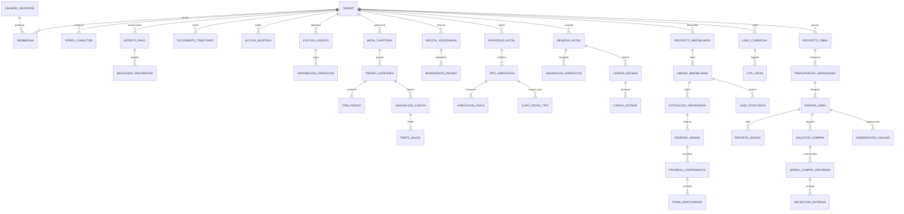

# Modelo Entidad-Relación Conceptual (MER) — Plataforma Salman

**Concilio Técnico:** Arquitecto de Datos · DBA PostgreSQL · Ingeniero de Software · Especialista en Modelado de Dominios · Analista de Requisitos · QA · Especialista AppSec.  
**Estado:** Canónico para Fase de Especificación SDD (Sin migraciones productivas).

---

## 1. Visión Holística del Dominio Multi-tenant

El modelo conceptual de `plataforma-salman` está estructurado bajo los principios de Domain-Driven Design (DDD) y la Constitución compartida (Principio I: Core primero, vertical después; Principio IV: Seguridad y privacidad desde la especificación).

---

## 2. Dominio 000-Core: Agregados Transversales

### A. Agregado de Identidad y Tenancy
- **Tenant:** Organización empresarial autónoma que posee aislamiento criptográfico y lógico absoluto. Ningún dato cruza fronteras de tenant sin un convenio explícito.
  - *Atributos esenciales:* `id`, `rut_empresa`, `razon_social`, `nombre_fantasia`, `estado` (ACTIVO, SUSPENDIDO, RETIRADO), `configuracion_regional` (zona horaria, formato CLP), `created_at`.
- **UsuarioIdentidad:** Sujeto de autenticación global (credenciales, 2FA, federación).
  - *Atributos esenciales:* `id`, `email`, `hash_autenticacion`, `telefono_e164`, `estado_identidad`, `fecha_registro`.
- **Membresia:** Vínculo formal entre un usuario y un tenant con asignación de roles.
  - *Atributos esenciales:* `id`, `tenant_id`, `usuario_id`, `rol_principal`, `estado_membresia` (INVITADA, ACTIVA, REVOCADA), `vigencia_desde`, `vigencia_hasta`.

### B. Agregado de Pagos y Conciliación
- **IntentoPago:** Registro inmutable de una transacción de cobro o devolución financiera.
  - *Atributos esenciales:* `id`, `tenant_id`, `idempotency_key`, `referencia_negocio_opaca` (UUID de pedido/reserva), `monto_clp` (entero), `moneda` ('CLP', 'UF', 'USD'), `proveedor` ('TRANSBANK_WEBPAY', 'MERCADOPAGO', 'STRIPE', 'FUDO_PAGOS'), `estado` (INICIADO, ENVIADO, AUTORIZADO, RECHAZADO, DESCONOCIDO, CONCILIADO, EN_DISPUTA), `created_at`.
- **ResultadoProveedor:** Callback o evento externo recibido de la pasarela de pagos.
  - *Atributos esenciales:* `id`, `tenant_id`, `intento_pago_id`, `codigo_autorizacion`, `token_transaccion_externo`, `payload_raw_hash`, `payload_raw_json`, `fecha_evento_proveedor`, `created_at`.
- **CasoConciliacion:** Registro de resolución ante discrepancias o estados desconocidos.
  - *Atributos esenciales:* `id`, `tenant_id`, `intento_pago_id`, `motivo_pendiente`, `operador_responsable_id`, `resolucion` (CONFIRMADO_MANUAL, REVERSADO, CASTIGADO), `created_at`.

### C. Agregado Tributario y Documental
- **ObligacionDocumental:** Requerimiento fiscal derivado de un cobro o devengo comercial.
  - *Atributos esenciales:* `id`, `tenant_id`, `referencia_negocio_opaca`, `monto_neto_clp`, `monto_iva_clp`, `monto_total_clp`, `tipo_sugerido` (BOLETA_ELECTRONICA, FACTURA_ELECTRONICA, COMPROBANTE_TRANSBANK).
- **DocumentoTributario:** Documento DTE oficial emitido ante el SII.
  - *Atributos esenciales:* `id`, `tenant_id`, `obligacion_id`, `tipo_dte` (39=Boleta, 33=Factura, 61=NotaCredito), `folio_dte`, `track_id_sii`, `estado_sii` (PENDIENTE, ACEPTADO, OBSERVADO, RECHAZADO), `xml_firmado_uri`, `created_at`.

### D. Agregado de Gobernanza Agéntica y Auditoría
- **PoliticaAgente:** Especificación de permisos y límites deterministas para agentes de IA.
  - *Atributos esenciales:* `id`, `tenant_id`, `agente_identificador` ('CONCIERGE_HOTEL', 'COMERCIAL_INM', 'EXTRACTOR_OBRA'), `limite_monetario_autonomo_clp` (inicial: 0), `herramientas_permitidas` (array), `requiere_aprobacion_humana` (booleano, true por defecto).
- **AprobacionOperacion:** Autorización formal humana de un solo uso para una acción crítica.
  - *Atributos esenciales:* `id`, `tenant_id`, `politica_id`, `proponente_agente_id`, `aprobador_humano_id`, `operacion_solicitada`, `huella_parametros_sha256`, `parametros_json`, `estado` (PENDIENTE, APROBADA, RECHAZADA, EXPIRADA), `expira_at`, `consumida_at`.
- **AccionAuditada:** Registro inmutable de eventos de auditoría y seguridad.
  - *Atributos esenciales:* `id`, `tenant_id`, `correlation_id`, `actor_id`, `tipo_actor` (HUMANO, AGENTE_IA, SISTEMA_EXTERNO), `accion`, `recurso`, `parametros_minimizados_json`, `resultado`, `hash_sha256`, `created_at`.

---

## 3. Dominio 001-Cafetería y POS

### Agregados y Entidades
- **MesaCafeteria:** Ubicación física o punto de consumo dentro del local.
  - *Atributos esenciales:* `id`, `tenant_id`, `codigo_mesa`, `capacidad_comensales`, `estado_mesa` (DISPONIBLE, OCUPADA, EN_LIMPIEZA, FUERA_DE_SERVICIO), `codigo_qr_token`.
- **PedidoCafeteria:** Orden de consumo agrupada por mesa o retiro.
  - *Atributos esenciales:* `id`, `tenant_id`, `mesa_id`, `numero_secuencia_diaria`, `estado_pedido` (BORRADOR, ENVIADO_COCINA, EN_PREPARACION, SERVIDO, ANULADO), `version_pedido`, `created_at`.
- **ItemPedido:** Línea de consumo individual enviada a comanda.
  - *Atributos esenciales:* `id`, `tenant_id`, `pedido_id`, `producto_id`, `cantidad`, `precio_unitario_clp`, `modificadores_json`, `estado_item` (PENDIENTE_COCINA, EN_COCCION, PREPARADO, ENTREGADO, CANCELADO).
- **AsignacionCuenta (Cuenta/Mesa):** Balanza financiera de la mesa para pago.
  - *Atributos esenciales:* `id`, `tenant_id`, `mesa_id`, `saldo_total_clp`, `saldo_pendiente_clp`, `saldo_liquidado_clp`, `estado_cuenta` (ABIERTA, EN_PAGO, LIQUIDADA, CERRADA).
- **ParteSaldo (Split de Cuenta):** Porción específica de la cuenta asignada a un pagador individual.
  - *Atributos esenciales:* `id`, `tenant_id`, `asignacion_cuenta_id`, `tipo_division` (POR_ITEMS, PARTES_IGUALES), `items_asignados_json`, `monto_subtotal_clp`, `monto_descuento_clp`, `monto_propina_clp`, `monto_residuo_redondeo_clp`, `monto_total_exigible_clp`, `estado_parte` (PENDIENTE, PAGADA_CONCILIADA, ANULADA), `intento_pago_id` (referencia al Core).
- **RecetaVersionada e IngredienteInsumo:** Estructura de costos y control de merma.
  - *Atributos esenciales:* `id`, `tenant_id`, `producto_id`, `version_receta`, `vigente_desde`, `insumos_detalle` (`insumo_id`, `cantidad_unitaria`, `unidad_medida`, `merma_esperada_pct`), `costo_calculado_clp`, `cobertura_costo_completa` (booleano).

### Invariantes Críticas de Cafetería
1. `saldo_pendiente_clp = saldo_total_clp - saldo_liquidado_clp`.
2. $\sum (\text{monto\_total\_exigible\_clp de ParteSaldo}) = \text{saldo\_total\_clp}$.
3. Un `ParteSaldo` en estado `PAGADA_CONCILIADA` es inmutable y no puede eliminarse ni reagruparse al deshacer una división de mesa.
4. Dividir financieramente una cuenta jamás modifica los estados de comanda en `ItemPedido` ni reenvía tickets a impresoras/KDS de cocina.

---

## 4. Dominio 002-Hotel y Reservas

### Agregados y Entidades
- **PropiedadHotel:** Recinto hotelero o complejo de alojamiento.
  - *Atributos esenciales:* `id`, `tenant_id`, `codigo_propiedad`, `nombre`, `direccion`, `politica_cancelacion_defecto`.
- **TipoHabitacion:** Categoría comercial de alojamiento (ej. Standard, Suite King).
  - *Atributos esenciales:* `id`, `tenant_id`, `propiedad_id`, `codigo_tipo`, `capacidad_adultos`, `capacidad_ninos`.
- **HabitacionFisica:** Recurso físico específico (número de puerta).
  - *Atributos esenciales:* `id`, `tenant_id`, `tipo_habitacion_id`, `numero_puerta`, `piso`, `estado_operativo` (DISPONIBLE, OCUPADA, BLOQUEADA_MANTENIMIENTO), `estado_limpieza` (SUCIA, EN_PROCESO, LIMPIA, INSPECCIONADA).
- **CupoFechaTipo:** Balanza de inventario comercial por fecha y categoría.
  - *Atributos esenciales:* `id`, `tenant_id`, `tipo_habitacion_id`, `fecha`, `cupo_total_inventario`, `cupo_bloqueado_tecnico`, `cupo_retenido_ofertas`, `cupo_reservado_confirmado`, `cupo_disponible_venta`.
- **ReservaHotel:** Contrato de alojamiento para una o varias noches.
  - *Atributos esenciales:* `id`, `tenant_id`, `propiedad_id`, `codigo_reserva`, `huesped_titular_id`, `canal_origen` ('MOTOR_DIRECTO', 'BOOKING', 'AIRBNB', 'RECEPCION'), `referencia_externa_canal`, `fecha_checkin`, `fecha_checkout`, `noches`, `estado_reserva` (PROPUESTA, RETENIDA_TEMPORAL, CONFIRMADA, CHECKED_IN, CHECKED_OUT, CANCELADA, EXPIRADA), `monto_alojamiento_clp`, `version_tarifa_id`.
- **AsignacionHabitacion:** Vinculación (tardía o previa) entre la reserva y la habitación física.
  - *Atributos esenciales:* `id`, `tenant_id`, `reserva_id`, `habitacion_fisica_id`, `fecha_asignacion`, `asignado_por_usuario_id`.
- **CuentaEstadia y CargoEstadia:** Folio de consumo durante el hospedaje.
  - *Atributos esenciales:* `id`, `tenant_id`, `reserva_id`, `cargos_alojamiento_clp`, `cargos_extras_clp` (room service, lavandería), `total_facturado_clp`, `total_pagado_clp`, `estado_cuenta_folio` (ABIERTA, CERRADA_SALDADA).
- **RecepcionEventoCanal (OTA Webhook/Cursor):** Buffer durable de sincronización.
  - *Atributos esenciales:* `id`, `tenant_id`, `canal_ota_id`, `external_notification_id`, `payload_hash`, `payload_json`, `recepcion_durable_at`, `procesado_at`, `estado_evento` (PENDIENTE, PROCESADO, ERROR_REINTENTABLE, CONFLICTO_SOBREVENTA).

### Invariantes Críticas de Hotel
1. `cupo_disponible_venta = cupo_total_inventario - (cupo_bloqueado_tecnico + cupo_retenido_ofertas + cupo_reservado_confirmado)`.
2. `cupo_disponible_venta >= 0` (Invariante estricta contra sobreventa).
3. Una habitación con `estado_operativo = 'BLOQUEADA_MANTENIMIENTO'` inhabilita el check-in de cualquier huésped, con independencia de que `estado_limpieza = 'LIMPIA'`.
4. Una reserva puede crearse, confirmarse y cobrarse sin asignar una `HabitacionFisica` específica, siempre que exista `cupo_disponible_venta > 0` en la categoría para todas las fechas de la estancia.

---

## 5. Dominio 003-Inmobiliaria Comercial

### Agregados y Entidades
- **ProyectoInmobiliario:** Desarrollo habitacional o comercial de la inmobiliaria.
  - *Atributos esenciales:* `id`, `tenant_id`, `codigo_proyecto`, `nombre_proyecto`, `comuna`, `politica_reserva_defecto_clp`.
- **UnidadInmobiliaria:** Departamento, casa, estacionamiento o bodega vendible.
  - *Atributos esenciales:* `id`, `tenant_id`, `proyecto_id`, `tipo_unidad` ('DEPARTAMENTO', 'CASA', 'ESTACIONAMIENTO', 'BODEGA'), `numero_unidad`, `superficie_util_m2`, `estado_comercial` (DISPONIBLE, COTIZADA, RESERVADA, PROMESADA, ESCRITURADA).
- **PrecioVersionado:** Catálogo de valores de la unidad con vigencia temporal.
  - *Atributos esenciales:* `id`, `tenant_id`, `unidad_id`, `version`, `precio_lista_uf`, `precio_lista_clp_referencial`, `vigente_desde`, `vigente_hasta`.
- **LeadComercial y ContactoPersona:** Prospecto comercial y datos personales protegidos.
  - *Atributos esenciales Lead:* `id`, `tenant_id`, `origen_canal` ('PORTAL_INMOBILIARIO', 'TOCTOC', 'WHATSAPP', 'SALA_VENTAS'), `estado_lead` (NUEVO, ASIGNADO, EN_CALIFICACION, CALIFICADO, DESCALIFICADO), `asignado_ejecutivo_id`.
  - *Atributos esenciales Contacto:* `id`, `tenant_id`, `lead_id`, `rut_dni`, `nombre_completo`, `email`, `telefono_e164`, `consentimiento_datos` (booleano).
- **DeclaracionCalificacion:** Datos declarados por el prospecto (no acreditados).
  - *Atributos esenciales:* `id`, `tenant_id`, `lead_id`, `ingreso_mensual_declarado_clp`, `preaprobacion_bancaria_declarada` (booleano), `banco_declarado`, `nivel_confianza_extraccion` (0.00 a 1.00), `auditado_humano` (booleano).
- **CotizacionVersionada:** Propuesta económica formal con plazo de vencimiento.
  - *Atributos esenciales:* `id`, `tenant_id`, `unidad_id`, `contacto_id`, `codigo_cotizacion`, `precio_acordado_uf`, `descuento_porcentaje`, `pie_porcentaje`, `plazo_dias_vigencia`, `vencimiento_at`, `estado_cotizacion` (VIGENTE, VENCIDA, RESERVADA, RECHAZADA).
- **ReservaUnidad:** Bloqueo comercial garantizado mediante abono monetario.
  - *Atributos esenciales:* `id`, `tenant_id`, `unidad_id`, `cotizacion_id`, `contacto_id`, `monto_abono_reserva_clp`, `estado_reserva` (EN_PROCESO_PAGO, CONFIRMADA_PAGADA, VENCIDA, DEVOLUCION_TRAMITADA), `intento_pago_id` (Core).
- **PromesaCompraventa y FirmaParticipante:** Contrato legal preparatorio.
  - *Atributos esenciales Promesa:* `id`, `tenant_id`, `unidad_id`, `reserva_id`, `numero_contrato`, `plantilla_legal_sha256`, `estado_promesa` (BORRADOR, EN_REVISION_LEGAL, ENVIADA_FIRMA, FIRMADA_PARCIAL, FIRMADA_COMPLETA, ESCRITURADA, RESCILIADA), `monto_precio_final_uf`.
  - *Atributos esenciales Firma:* `id`, `tenant_id`, `promesa_id`, `firmante_tipo` ('COMPRADOR', 'REPRESENTANTE_LEGAL', 'CONYUGE'), `firmante_id`, `proveedor_firma` ('TOC', 'IDOK', 'FIRMA_GOB'), `evidencia_firma_token`, `firmado_at`.
- **VinculoUnidad:** Titularidad de acceso al portal y posventa por unidad vendida.
  - *Atributos esenciales:* `id`, `tenant_id`, `unidad_id`, `persona_id`, `rol_vinculo` ('PROPIETARIO', 'ARRENDATARIO', 'ADMINISTRADOR'), `vigente_desde`, `vigente_hasta`, `permisos_portal_json`.
- **CasoPostventa:** Solicitud de garantía o reparación sobre una unidad entregada.
  - *Atributos esenciales:* `id`, `tenant_id`, `unidad_id`, `vinculo_id`, `categoria_falla`, `estado_caso` (RECIBIDO, ASIGNADO, EN_INSPECCION, TRABAJO_PROGRAMADO, RESUELTO_PROPUESTO, CERRADO_ACEPTADO, REABIERTO), `responsable_postventa_id`, `created_at`.

### Invariantes Críticas de Inmobiliaria
1. Para una `UnidadInmobiliaria`, solo puede existir **una única** `ReservaUnidad` en estado `CONFIRMADA_PAGADA` o `PromesaCompraventa` en estado no terminal.
2. Emitir una `CotizacionVersionada` no altera el `estado_comercial` de la unidad ni restringe su cotización a otros prospectos.
3. El paso de `ReservaUnidad` a `PromesaCompraventa` requiere obligatoriamente que `ReservaUnidad.estado_reserva = 'CONFIRMADA_PAGADA'`.
4. La revocación o reasignación de un `VinculoUnidad` no transfiere dominio jurídico ni afecta los vínculos de otras unidades pertenecientes a la misma persona.

---

## 6. Dominio 004-Constructora y Control de Obra

### Agregados y Entidades
- **ProyectoObra:** Centro de costo y ejecución física de construcción.
  - *Atributos esenciales:* `id`, `tenant_id`, `codigo_obra`, `nombre_obra`, `direccion`, `presupuesto_base_clp`, `fecha_inicio_programada`, `proyecto_inmobiliario_id` (vínculo opcional).
- **PresupuestoVersionado y PartidaObra:** Desglose analítico de partidas (WBS).
  - *Atributos esenciales Presupuesto:* `id`, `tenant_id`, `obra_id`, `version_presupuesto`, `estado_presupuesto` (LINEA_BASE, VIGENTE_APROBADO, EN_REVISION), `costo_total_presupuestado_clp`.
  - *Atributos esenciales Partida:* `id`, `tenant_id`, `presupuesto_id`, `itemizado_codigo` (ej. '01.02.03'), `descripcion`, `unidad_medida` ('M3', 'M2', 'ML', 'KG', 'UN'), `cantidad_presupuestada`, `precio_unitario_clp`, `total_partida_clp`.
- **ParteTrabajo y ValorAvance:** Registro diario de avance físico por frente de trabajo.
  - *Atributos esenciales Parte:* `id`, `tenant_id`, `obra_id`, `fecha_hecho`, `turno` ('MANANA', 'TARDE', 'NOCHE'), `frente_trabajo`, `jefe_obra_id`, `created_at`.
  - *Atributos esenciales ValorAvance:* `id`, `tenant_id`, `parte_trabajo_id`, `partida_id`, `tipo_registro` ('INCREMENTO_TURNO', 'ACUMULADO_RECTIFICADO'), `cantidad_avance_fisico`, `porcentaje_calculado_pct`, `estado_aprobacion` (BORRADOR, EXTRAIDO_IA, APROBADO_ITO, RECHAZADO).
- **RegistroInspeccion y ObservacionCalidad (Punch List):** Control de calidad y fallas.
  - *Atributos esenciales Inspección:* `id`, `tenant_id`, `obra_id`, `partida_id`, `inspector_ito_id`, `fecha_inspeccion`, `resultado_global` ('CONFORME', 'CON_OBSERVACIONES', 'RECHAZADO').
  - *Atributos esenciales Observación:* `id`, `tenant_id`, `inspeccion_id`, `numero_observacion`, `descripcion_falla`, `severidad` ('LEVE', 'MEDIA', 'CRITICA'), `solucionador_asignado_id`, `estado_observacion` (ABIERTA, ASIGNADA, SOLUCION_PROPUESTA, CERRADA_ACEPTADA, REABIERTA), `created_at`.
- **SolucionPropuesta y AprobacionCierre:** Ciclo de resolución con roles segregados.
  - *Atributos esenciales Solución:* `id`, `tenant_id`, `observacion_id`, `descripcion_trabajo_reparacion`, `evidencia_fotografica_uri`, `propuesta_por_id`, `propuesta_at`.
  - *Atributos esenciales Cierre:* `id`, `tenant_id`, `observacion_id`, `aprobada_por_ito_id`, `comentario_cierre`, `cerrada_at`.
- **SolicitudCompra y OrdenCompraAprobada:** Cadena de abastecimiento de materiales.
  - *Atributos esenciales Solicitud:* `id`, `tenant_id`, `obra_id`, `partida_id`, `solicitante_id`, `numero_solicitud`, `estado_solicitud` (BORRADOR_PROPUESTO, EN_COTIZACION, APROBADA, RECHAZADA).
  - *Atributos esenciales Orden:* `id`, `tenant_id`, `solicitud_id`, `proveedor_id`, `numero_oc`, `total_comprometido_clp`, `estado_oc` (EMITIDA, CONFIRMADA_PROVEEDOR, RECEPCION_PARCIAL, RECEPCION_TOTAL, CANCELADA).
- **RecepcionEntrega y RecepcionLineaMaterial:** Control físico de ingreso a bodega.
  - *Atributos esenciales Entrega:* `id`, `tenant_id`, `orden_compra_id`, `guia_despacho_numero`, `fecha_recepcion`, `bodeguero_receptor_id`.
  - *Atributos esenciales Línea:* `id`, `tenant_id`, `entrega_id`, `partida_id`, `material_id`, `cantidad_facturada_guia`, `cantidad_fisica_aceptada`, `cantidad_fisica_rechazada`, `cantidad_devuelta`.
- **ObligacionCosto (Control Presupuestario de Obra):** Trazabilidad de compromisos.
  - *Atributos esenciales:* `id`, `tenant_id`, `obra_id`, `partida_id`, `monto_presupuestado_clp`, `monto_comprometido_oc_clp`, `monto_devengado_recepcion_clp`, `monto_pagado_clp`, `saldo_disponible_clp`.

### Invariantes Críticas de Constructora
1. `saldo_disponible_clp = monto_presupuestado_clp - monto_comprometido_oc_clp`. El devengo y el pago son fases de liquidación de la orden comprometida y no se vuelven a restar del saldo disponible.
2. En `RecepcionLineaMaterial`, para una orden de compra: $\sum \text{cantidad\_fisica\_aceptada} \le \text{cantidad\_pedida\_aprobada}$ (todo exceso requiere orden complementaria o autorización expresa).
3. `ObservacionCalidad.estado_observacion = 'CERRADA_ACEPTADA'` requiere de forma obligatoria que `aprobada_por_ito_id != solucionador_asignado_id` (segregación de funciones entre quien ejecuta y quien fiscaliza).
4. La recepción de materiales en bodega incrementa el stock de inventario, pero **no** computa como avance físico en `ValorAvance` ni acredita certificación de obra ante mandantes.
