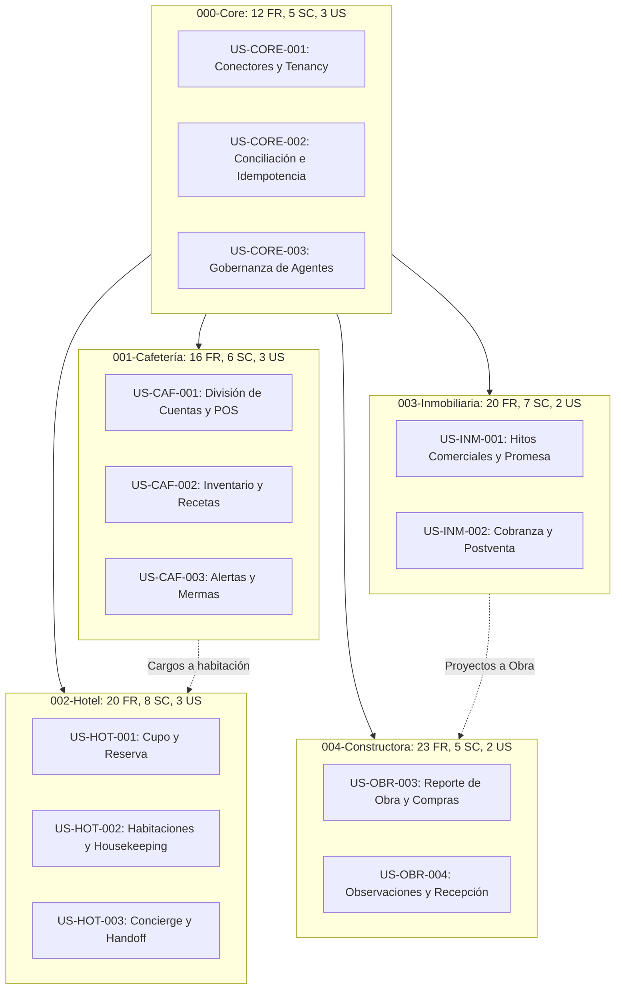

# Matriz de Trazabilidad Unificada de Extremo a Extremo

Esta matriz vincula cada fuente de evidencia competitiva con el hallazgo reconciliado, el problema del usuario, la historia de usuario canónica, los requisitos funcionales y no funcionales, los criterios de aceptación Given/When/Then, los artefactos SDD de Spec Kit y las tareas de implementación proyectadas.

---

## 1. Tabla de Trazabilidad Completa

| Evidencia Primaria | Hallazgo Reconciliado | Actor y Necesidad de Negocio | Historia Canónica / Alias | Requisitos Vinculados (FR / NFR) | Criterios de Aceptación Clave | Artefactos Canónicos Spec Kit | Tarea Proyectada (`tasks.md`) |
|---|---|---|---|---|---|---|---|
| **C04, I10, I17, H13** | Aislamiento de conectores por tenant, país y plan; sin secretos cruzados. | Administrador de empresa: habilitar integraciones sin exponer credenciales a otros tenants. | `000-core/H1` ↔ `US-CORE-001` | FR-001, FR-002, FR-006, FR-010; NFR-001, NFR-002, NFR-006 | `AC-US-CORE-001-01`, `AC-US-CORE-001-02` | `specs/000-core/` (`spec.md`, `acceptance.md`, `data-model.md`, `contracts/README.md`) | `T-CORE-01` |
| **C06, H01, H15, I19** | Máquina de estados de conciliación; eventos tardíos no retroceden estado resuelto. | Operador de conciliación: distinguir solicitud enviada de efecto confirmado para no duplicar cobros. | `000-core/H2` ↔ `US-CORE-002` | FR-003, FR-004, FR-008, FR-011, FR-012; NFR-001, NFR-003, NFR-006 | `AC-US-CORE-002-01`, `AC-US-CORE-002-02` | `specs/000-core/` (`spec.md`, `acceptance.md`, `data-model.md`, `contracts/README.md`) | `T-CORE-02` |
| **I06, I07, H10, I11** | Gobernanza agéntica: precondiciones verificadas fuera de prompt y límite 0 CLP. | Responsable de seguridad: validar propuestas de IA antes de cualquier mutación de negocio. | `000-core/H3` ↔ `US-CORE-003` | FR-005, FR-007, FR-009, FR-010; NFR-002, NFR-004, NFR-006 | `AC-US-CORE-003-01`, `AC-US-CORE-003-02` | `specs/000-core/` (`spec.md`, `acceptance.md`, `data-model.md`, `contracts/README.md`) | `T-CORE-03` |
| **C02, C05, C07, C11, C12** | Split financiero de cuenta desacoplado de comandas de cocina y blindaje de pagos previos. | Comensal y cajero: pagar partes de una cuenta en CLP sin duplicar órdenes en cocina. | `001-cafeteria-mesas-pos/H1` ↔ `US-CAF-001` | FR-001, FR-002, FR-003, FR-004, FR-005, FR-015; NFR-006 | `AC-US-CAF-001-01`, `AC-US-CAF-001-02` | `specs/001-cafeteria-mesas-pos/` (`spec.md`, `acceptance.md`, `data-model.md`, `contracts/README.md`) | `T-CAF-01` |
| **C08, C10, C04, C12** | Procedencia de inventario y recetas; costo no reportado nunca se computa como cero. | Administrador de local: calcular margen real sin ocultar discrepancias de costeo. | `001-cafeteria-mesas-pos/H2` ↔ `US-CAF-002` | FR-007, FR-008, FR-009, FR-010; NFR-006 | `AC-US-CAF-002-01`, `AC-US-CAF-002-02` | `specs/001-cafeteria-mesas-pos/` (`spec.md`, `acceptance.md`, `data-model.md`, `contracts/README.md`) | `T-CAF-02` |
| **C09, C10, C13** | Detección de mermas y propuestas de reposición con deduplicación y expiración explícita. | Encargado de compras: recibir sugerencias de compra auditables sin compras automáticas. | `001-cafeteria-mesas-pos/H3` ↔ `US-CAF-003` | FR-011, FR-012, FR-013, FR-016; NFR-006 | `AC-US-CAF-003-01`, `AC-US-CAF-003-02` | `specs/001-cafeteria-mesas-pos/` (`spec.md`, `acceptance.md`, `data-model.md`, `contracts/README.md`) | `T-CAF-03` |
| **H01..H04, H11, H12, H18** | Cupo por categoría separado de asignación física; cambio/cancelación con tarifa versionada. | Huésped y recepcionista: reservar habitación garantizada sin sobreventa ni pérdidas de saldo. | `002-hotel-reservas-concierge/H1` ↔ `US-HOT-001` | FR-001..FR-005, FR-016, FR-018; NFR-006 | `AC-US-HOT-001-01`, `AC-US-HOT-001-02`, `AC-P01-01/02/03`, `AC-P02-01/02/03` | `specs/002-hotel-reservas-concierge/` (`spec.md`, `acceptance.md`, `data-model.md`, `contracts/README.md`) | `T-HOT-01` |
| **H05, H01, H14, H16** | Desacoplamiento de housekeeping, mantenimiento y disponibilidad futura; cargos periódicos. | Recepcionista y ama de llaves: preparar habitaciones y asignar cargos extras sin cruces. | `002-hotel-reservas-concierge/H2` ↔ `US-HOT-002` | FR-006..FR-009, FR-016, FR-019; NFR-006 | `AC-US-HOT-002-01`, `AC-US-HOT-002-02`, `AC-P03-01/02/03` | `specs/002-hotel-reservas-concierge/` (`spec.md`, `acceptance.md`, `data-model.md`, `contracts/README.md`) | `T-HOT-02` |
| **H06..H10, H13, H15** | Concierge conversacional con handoff estructurado y acuse durable de recepción OTA. | Huésped y soporte: recibir atención continua sin que la IA emita compromisos no autorizados. | `002-hotel-reservas-concierge/H3` ↔ `US-HOT-003` | FR-010..FR-014, FR-017, FR-020; NFR-006 | `AC-US-HOT-003-01`, `AC-US-HOT-003-02`, `AC-P04-01/02/03` | `specs/002-hotel-reservas-concierge/` (`spec.md`, `acceptance.md`, `data-model.md`, `contracts/README.md`) | `T-HOT-03` |
| **I01, I03..I05, I09, I10, I12, I14, I15, I17, I18** | Secuencia de hitos comerciales verificables; agenda estática vs sincronizada; firma legal. | Prospecto y ejecutivo comercial: avanzar desde consulta hasta promesa firmada con validez legal. | `003-inmobiliaria-comercial/H1` ↔ `US-INM-001` | FR-001..FR-006, FR-015..FR-018; NFR-006 | `AC-US-INM-001-01`, `AC-US-INM-001-02`, `AC-P05-01/02/03`, `AC-P06-01/02/03` | `specs/003-inmobiliaria-comercial/` (`spec.md`, `acceptance.md`, `data-model.md`, `contracts/README.md`) | `T-INM-01` |
| **I02, I06, I11, I13, I16** | Cobranza y postventa; segregación estricta entre entidad Persona y VínculoUnidad. | Cliente y postventa: gestionar reclamos y pagos sin divulgar deudas ni alterar titularidades. | `003-inmobiliaria-comercial/H2` ↔ `US-INM-002` | FR-007..FR-009, FR-016, FR-019, FR-020; NFR-006 | `AC-US-INM-002-01`, `AC-US-INM-002-02`, `AC-P07-01/02/03` | `specs/003-inmobiliaria-comercial/` (`spec.md`, `acceptance.md`, `data-model.md`, `contracts/README.md`) | `T-INM-02` |
| **O03, O05, O07, O08, O11, O14, O17, O18** | Reporte diario por turnos y deduplicación por origen; control presupuestario de compras. | Jefe de obra y abastecimiento: reportar avance real y compras sin duplicar compromisos. | `004-constructora-obra/H3` ↔ `US-OBR-003` | FR-010..FR-012, FR-015, FR-020, FR-021, FR-023; NFR-006 | `AC-US-OBR-003-01`, `AC-US-OBR-003-02`, `AC-P08-01/02/03`, `AC-P10-01/02/03` | `specs/004-constructora-obra/` (`spec.md`, `acceptance.md`, `data-model.md`, `contracts/README.md`) | `T-OBR-01` |
| **O01, O02, O06, O09, O10, O12, O13, O15** | Observaciones de calidad (punch list) con roles segregados; recepción parcial de bodega. | Inspector y bodeguero: registrar fallas y recepcionar materiales sin computar avance falso. | `004-constructora-obra/H4` ↔ `US-OBR-004` | FR-015..FR-020, FR-022; NFR-006 | `AC-US-OBR-004-01`, `AC-US-OBR-004-02`, `AC-P09-01/02/03` | `specs/004-constructora-obra/` (`spec.md`, `acceptance.md`, `data-model.md`, `contracts/README.md`) | `T-OBR-02` |

---

## 2. Cobertura de Requisitos Canónicos por Vertical

- **Total Requisitos Funcionales Canónicos:** 77 FRs (distribuidos en 12 Core, 16 Cafetería, 20 Hotel, 20 Inmobiliaria, 23 Constructora).
- **Total Criterios de Éxito:** 31 SCs cuantificables con denominadores explícitos.
- **Total Criterios de Aceptación:** 65 ACs estructurados en Given/When/Then.
- **Comprobación de Dependencias:** El grafo de dependencias entre features es completamente acíclico y verificable de forma determinista mediante `validar_documentacion.py`.
