# Dependencias y orden de ingeniería

Las flechas indican **consumidor → proveedor**. Líneas sólidas son dependencia de capacidad; punteadas son integración opcional. No hay ciclos.

```mermaid
graph TD
 C[001 Cafetería] --> K[000 Core]
 H[002 Hotel] --> K
 I[003 Comercial] --> K
 O[004 Obra] --> K
 H -. Servicio habitación opcional .-> C
 O -. Correspondencia proyecto opcional .-> I
 H --> P[PMS o adaptador hotelero seleccionado]
 P --> CM[Channel manager autorizado o conectores aprobados]
 CM --> OTA[Booking y Airbnb]
 K --> PAY[Proveedor de pagos y documental por contribuyente]
 I --> SIG[Proveedor de firma y política legal]
```

## Eliminación de acoplamientos

Hotel H1 requiere core e inventario hotelero confiable, no cafetería en producción. H2 de servicio a habitación puede consumir contrato lógico pedido/cargo con identificador externo e idempotencia. Una alternativa es un adaptador del proveedor gastronómico; evita duplicar cocina y no obliga a colocar pedidos en core. Cargo de habitación y pago al restaurante no son equivalentes; la conciliación depende de quién factura y de la relación entre empresas.

Obra no necesita compradores, promesas ni estado comercial para medir avance. Puede comenzar con sus propios proyectos y vincular IDs a 003 cuando exista convenio; no necesita acceder a la base comercial. La dependencia original de un supuesto módulo previo de inspección no puede satisfacerse con los archivos entregados y se registra como bloqueo, no código existente.

PMS/channel manager es frontera externa: disponibilidad y reservas requieren propietario único por recurso/fecha. La base local no elimina carreras de OTA; usar cupos seguros o detener confirmación cuando falte evidencia de sincronización. No usar iCal como equivalente demostrado de sincronización bidireccional <5 min.

## Orden recomendado

1. Aclaraciones de empresas, políticas fiscales, datos y alcance; ratificar constitución.
2. 000: contratos y pruebas de aislamiento, idempotencia y auditoría; habilitar solo capacidades necesitadas por primer flujo.
3. 001 H1 si se resuelve caja/pago; 003 H1 puede desarrollarse independientemente después de su revisión legal. Son opciones de secuencia comercial, no dependencias entre ellas.
4. 002 H1 tras seleccionar PMS y acceso a canales; room service se integra después del contrato de pedidos.
5. 004 tras presupuesto y roles de obra, como V2 comercial; no exige 003 en producción.
6. Agentes primero en lectura y borrador, después sandbox y evaluación, finalmente escritura acotada solo tras aprobación de políticas.

Cada paso tiene gate por feature; no se declara un calendario ni esfuerzo sin equipo, presupuesto y volumen confirmados.
