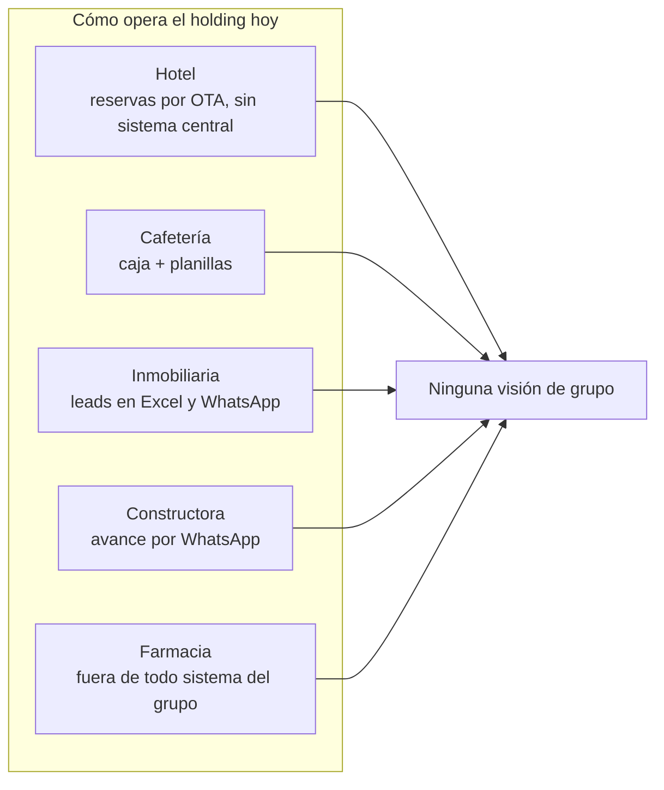
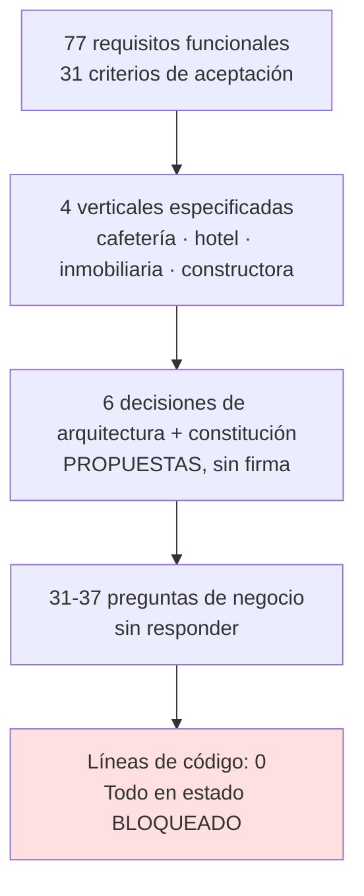
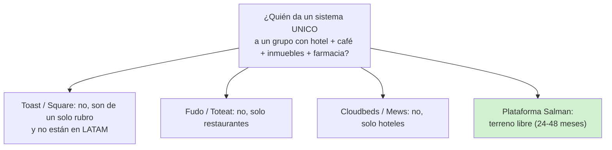
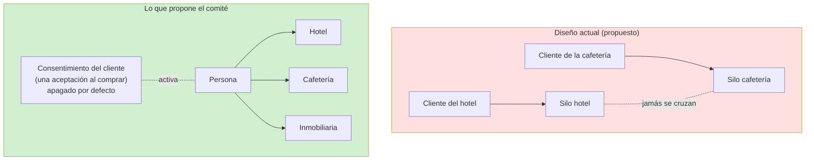
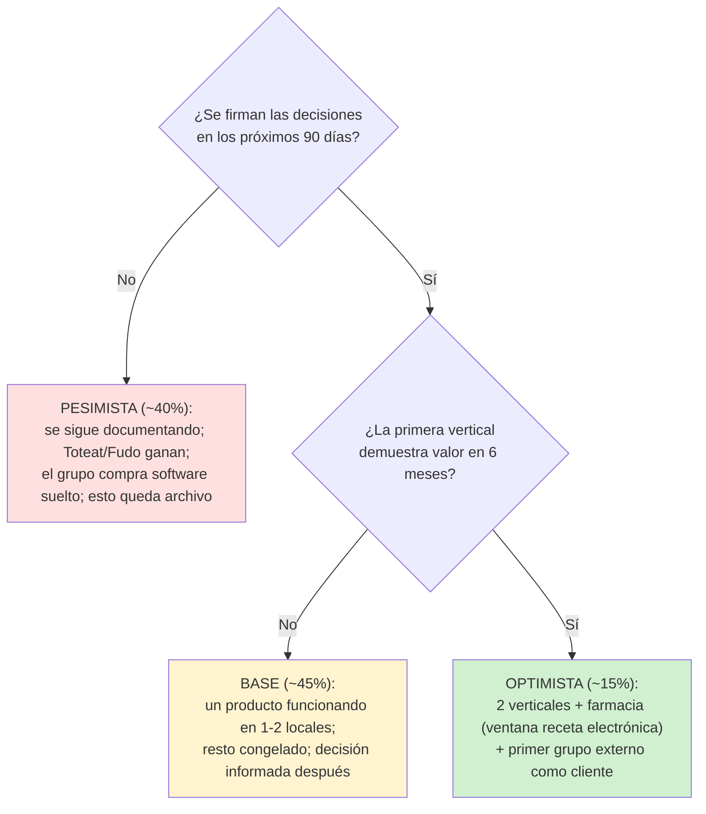
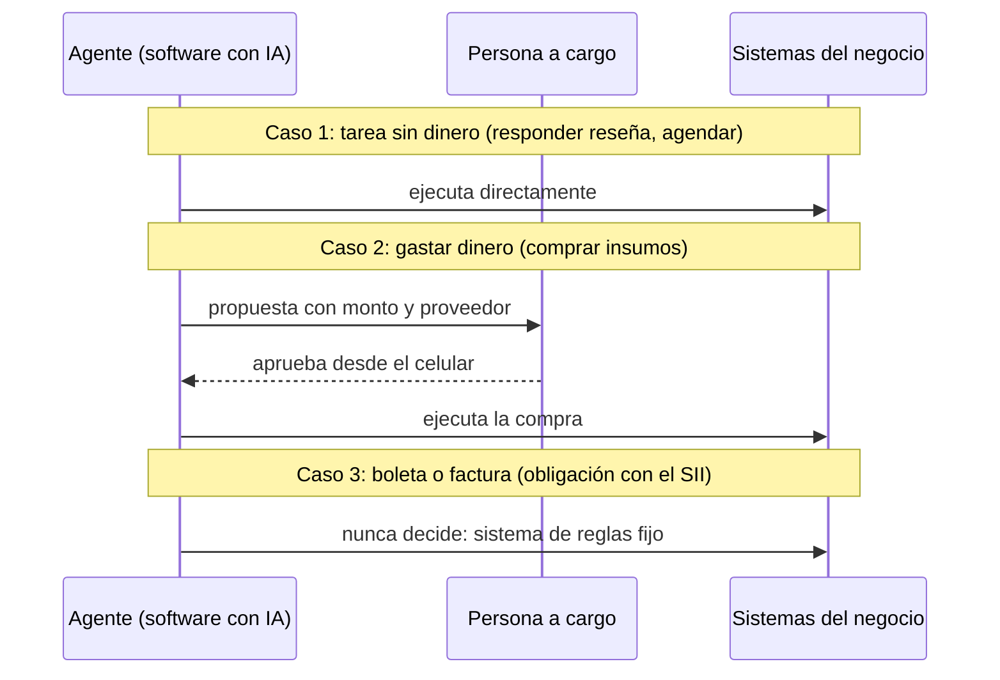
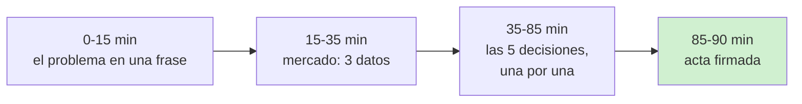

# Presentación de Decisión — Plataforma Salman

**Clasificación:** PROPUESTA DE COMITÉ · **Formato:** 12 láminas, cada diagrama acompañado de su explicación en palabras simples. Los diagramas se renderizan en GitHub (Mermaid).

---

## Lámina 1 — Portada

**Plataforma Salman: de los silos a la plataforma del grupo**
Sesión de decisión · 90 minutos · Paquete de evaluación independiente (oct-2026)

> **En palabras simples:** esta no es una reunión para informar. Es la reunión donde se firman o se rechazan las decisiones que llevan meses pendientes.

---

## Lámina 2 — El problema de hoy

> **En palabras simples:** cada negocio vive en su isla. Nadie del grupo puede responder "¿cuánto facturamos en conjunto este mes?" sin armar planillas a mano. Ese era el problema que este proyecto debía resolver.

---

## Lámina 3 — Qué existe hoy: mucho documento, cero código

> **En palabras simples:** hay un diseño detallado y auditado —como los planos de una casa—, pero nadie ha aprobado los planos y no se ha movido un solo ladrillo. Y hay más de 30 preguntas sobre el negocio que solo el grupo puede responder y siguen abiertas.

---

## Lámina 4 — El mercado en 3 datos

| Dato | Qué significa para el holding |
|---|---|
| Toast: 164.000 locales, US$195B procesados (2025), **sin entrar a LATAM** | El modelo ganador (software + pagos + agentes) no ha llegado; hay tiempo, no mucho |
| Toteat (Chile) levantó US$7,4M (sep-2025); Fudo supera 25.000 clientes | Los locales están creciendo y agregando IA; cada mes de espera es mercado que se asienta |
| **Nadie cubre la plataforma de grupo familiar multi-vertical en LATAM** (verificado oct-2026) | La oportunidad del holding existe y está libre: ventana estimada 24-48 meses |

> **En palabras simples:** los gigantes no han llegado, los locales están acelerando, y el terreno que el holding podría ocupar —ser la plataforma de un grupo de negocios— está vacío. Las ventanas así no se avisan dos veces.

---

## Lámina 5 — La oportunidad: el terreno está libre

> **En palabras simples:** cada proveedor fuerte hace una cosa. Ninguno hace "el sistema del grupo". Ese hueco es exactamente lo que el holding necesita para sí mismo — y lo que podría luego vender a otros grupos familiares.

---

## Lámina 6 — El hallazgo central: un candado que nadie decidió poner

> **En palabras simples:** el diseño actual prohíbe que el sistema reconozca al mismo cliente en dos negocios del grupo. La ley chilena nueva (vigente desde dic-2026) **no lo prohíbe**: pide el consentimiento del cliente, como un checkbox. El comité propone guardar esa llave: apagado por defecto, activable por negocio. Si en dos años el dueño pregunta "¿por qué no sabemos quién es nuestro cliente común?", la respuesta no puede ser "un papel sin firmar lo prohibió".

---

## Lámina 7 — Los tres escenarios a 36 meses

**Gatillos observables (primeros 90 días):** constitución firmada con fecha · stack elegido · inventario operativo entregado por el grupo · primer commit del núcleo.

> **En palabras simples:** el escenario malo no depende de la tecnología, depende de una firma. Si en 90 días no hay constitución aprobada, ya estamos en el escenario rojo — y se puede saber sin esperar 3 años.

---

## Lámina 8 — Dictamen: MODIFICAR (no seguir tal cual, no abandonar)

| # | Modificación obligatoria | Por qué |
|---|---|---|
| 1 | Cliente transversal **por consentimiento**, apagado por defecto | Mantiene la tesis del holding sin riesgo legal |
| 2 | **Una vertical primero** (cafetería u hotel), las demás congeladas | Así crecieron todos los players que hoy dominan |
| 3 | Agentes **por política**: autónomos en tareas sin dinero, aprobación humana en gastos, regla fija en boletas/facturas | Gobernanza es producto (Toast cobra por ella), no freno |
| 4 | **Farmacia: decisión explícita con fecha** | Su regulación abierta (receta electrónica, nov-2025) da ~24-36 meses de ventana |
| 5 | **Ratificar constitución y 6 ADRs con fecha límite** | Sin firma, todo lo demás es papel |

> **En palabras simples:** el diseño es bueno material, pero tiene una decisión clave al revés, demasiado papel sin ladrillos, y un negocio del grupo (farmacia) que nadie miró. Se corrige, no se tira.

---

## Lámina 9 — Las 5 decisiones de hoy

| # | Decisión | Costo de postergarla 6 meses |
|---|---|---|
| 1 | Ratificar constitución y ADRs | Nada avanza sin esto |
| 2 | Cliente transversal: consentimiento vs prohibición | Unificar identidades después cuesta 10 a 50 veces más |
| 3 | Stack tecnológico (lenguaje, base de datos, hosting) | No se puede contratar ni escribir código |
| 4 | Primera vertical + qué pasa con el software actual | Es la definición del producto; el mercado no espera |
| 5 | Farmacia: dentro o fuera | La ventana regulatoria se cierra sola |

> **En palabras simples:** estas cinco son baratas hoy (son decisiones de una reunión) y caras después (son obras de demolición). Por eso se deciden hoy, una por una: firma, rechazo con fecha, o aplazamiento con fecha.

---

## Lámina 10 — Cómo trabajaría un agente con gobernanza (ejemplo real)

> **En palabras simples:** el agente es como un encargado con tarjeta limitada. Para tareas sin plata, trabaja solo. Para gastar, pide permiso por teléfono y el permiso sirve una sola vez y por el monto exacto. Para documentos tributarios no decide nada: ahí manda la regla fija, porque un error le cuesta multa al holding. Esto es lo que ya vende Toast en EE.UU. a US$699/mes.

---

## Lámina 11 — Lo que NO se está proponiendo hoy

- ❌ Escribir código mañana (primero se firma el diseño; la fase sigue siendo documental)
- ❌ Compartir datos de clientes sin permiso (la llave del consentimiento está apagada por defecto)
- ❌ Reemplazar de golpe los sistemas actuales (la convivencia con Eleventa y el PMS actual es decisión #4, con datos del grupo)
- ❌ Prometer las 4 verticales (se implementa una; las otras quedan como opciones evaluadas)

> **En palabras simples:** hoy no se gasta dinero de desarrollo. Se cierran decisiones para que el próximo peso invertido vaya en lo correcto.

---

## Lámina 12 — Agenda de la sesión y regla de cierre

**Regla de cierre:** cada decisión termina en **firmada**, **rechazada con fecha**, o **diferida con fecha**. "Lo pensamos" sin fecha = no, y activa el escenario pesimista.

**Material previo enviado (T-7 días):** resumen ejecutivo + cuestionario de 12 preguntas que solo el grupo puede responder (`03-cuestionario-previo.md`).

---

*Fuentes de mercado con fecha en `01-resumen-ejecutivo.md` y en el informe completo del comité. Lo no verificable se declara como tal.*
